# Codebase Map — A Guide to Learning OpenSquilla's Source

This is a developer-facing map of the `opensquilla` source tree: what each
subsystem does, how they depend on one another, and a suggested reading order
for someone new to the codebase. It complements the user-facing docs in
[`docs/README.md`](README.md) — those explain *what OpenSquilla does*; this
explains *how the code is put together*.

Scope: `src/opensquilla/` (~30 subsystems, ~1,000 Python files), the
`opensquilla-webui/` Vue frontend, `desktop/electron/`, and
`packages/opensquilla-tui-host/`.

---

## 1. The one-paragraph mental model

OpenSquilla is a **microkernel agent**: a single **Gateway** daemon (Starlette
ASGI + WebSocket RPC) is the hub that every client — CLI, TUI, Web UI, chat
channels (Slack/Discord/...) — connects to. The Gateway wraps a **turn
execution engine** (`engine/`, centered on `TurnRunner` and `Agent`) that runs
one conversational turn: assemble context, ask **SquillaRouter** which model
tier to use, call a **Provider** adapter (Anthropic/OpenAI/Ollama/...), dispatch
any **tool calls** through a policy-gated, **sandboxed** execution path, and
persist everything to a **Session** + **Memory** store. Nearly every other
directory (`skills/`, `safety/`, `search/`, `observability/`, `scheduler/`,
`onboarding/`, ...) is a plugin or support service around that one loop.

If you remember one flow, remember this:

```
CLI/TUI/WebUI/Channel  →  Gateway (RPC/ASGI)  →  Engine (TurnRunner/Agent)
                                                     │
                    ┌────────────────────────────────┼─────────────────────────┐
                    ▼                                 ▼                         ▼
            SquillaRouter (pick model)        Provider (call LLM API)   Tools + Sandbox (act)
                    │                                 │                         │
                    └────────────────► Session + Memory (persist) ◄─────────────┘
```

---

## 2. Code structure graph

```mermaid
graph TD
    subgraph Entry Points
        CLI["cli/<br/>Typer CLI, chat/repl/tui launchers"]
        WebUI["opensquilla-webui/<br/>Vue control console + chat"]
        Desktop["desktop/electron/<br/>Electron shell"]
        TuiHost["packages/opensquilla-tui-host/<br/>terminal UI host binary shim"]
        Channels["channels/<br/>Slack, Discord, Telegram, ..."]
    end

    subgraph Hub
        Gateway["gateway/<br/>Starlette daemon, WebSocket RPC,<br/>session/auth/scopes, boot wiring"]
        Application["application/<br/>approval queue, setup wizard"]
    end

    subgraph Core Loop
        Engine["engine/<br/>TurnRunner + Agent: the turn state machine"]
        SessionMod["session/<br/>SessionManager, transcript, compaction"]
        Chat["chat/<br/>UI-neutral request/message contracts"]
        Agents["agents/<br/>durable named agents, spawn limits"]
    end

    subgraph Decide + Call Model
        Router["squilla_router/<br/>on-device ONNX model-tier classifier"]
        Provider["provider/<br/>LLMProvider adapters: Anthropic, OpenAI,<br/>Ollama, ensemble, ..."]
    end

    subgraph Act
        Tools["tools/<br/>registry + dispatch pipeline"]
        Sandbox["sandbox/<br/>SecurityLevel posture, platform backends"]
        Safety["safety/<br/>injection guard, risk tiers, permission matrix"]
        Skills["skills/<br/>MetaSkills: DAG workflows over tools/agents"]
        MCP["mcp/ + mcp_server/<br/>outbound + inbound MCP bridges"]
    end

    subgraph Persist + Learn
        Memory["memory/<br/>SQLite+FTS5+sqlite-vec store, dream consolidation"]
        Persistence["persistence/<br/>yoyo schema migrations gate"]
        Search["search/<br/>web search provider registry (a tool)"]
        Observability["observability/<br/>decision log, safety log, replay"]
    end

    subgraph Support Services
        Scheduler["scheduler/<br/>cron / recurring jobs"]
        Onboarding["onboarding/<br/>provider/channel setup flows"]
        Identity["identity/<br/>persona docs → system prompt"]
        Health["health/<br/>readiness diagnostics"]
        Migration["migration/<br/>import from legacy agent CLIs"]
        Recovery["recovery/<br/>desktop install profile repair"]
        Uninstall["uninstall/<br/>inventory-driven uninstaller"]
    end

    Kernel["top-level src/opensquilla/*.py<br/>paths, env, secrets, permissions,<br/>context_budget, tool_boundary (leaf utilities)"]

    CLI -->|WebSocket RPC| Gateway
    WebUI -->|WebSocket RPC| Gateway
    Desktop --> WebUI
    Desktop -->|spawns child process| Gateway
    TuiHost -.->|exec resolved binary| CLI
    Channels --> Gateway

    Gateway --> Application
    Gateway --> Engine
    Gateway --> Memory
    Gateway --> Scheduler
    Gateway --> Onboarding
    Gateway --> SessionMod

    Engine --> SessionMod
    Engine --> Chat
    Engine --> Agents
    Engine --> Router
    Engine --> Provider
    Engine --> Tools
    Engine --> Observability
    Engine --> Identity
    Engine -.snapshot.-> Memory

    Router -.decision.-> Provider

    Tools --> Sandbox
    Tools --> Safety
    Tools --> Search
    Tools --> MCP
    Skills --> Engine
    Skills --> Tools

    SessionMod --> Persistence
    Memory --> Persistence

    CLI --> Kernel
    Gateway --> Kernel
    Engine --> Kernel
    Provider --> Kernel

    classDef entry fill:#2b6cb0,color:#fff,stroke:#1a4971;
    classDef hub fill:#b7791f,color:#fff,stroke:#7c5210;
    classDef core fill:#276749,color:#fff,stroke:#1a4531;
    classDef decide fill:#6b46c1,color:#fff,stroke:#44337a;
    classDef act fill:#9c4221,color:#fff,stroke:#652b13;
    classDef persist fill:#2c7a7b,color:#fff,stroke:#1d4e4f;
    classDef support fill:#4a5568,color:#fff,stroke:#2d3748;
    classDef kernel fill:#718096,color:#fff,stroke:#4a5568;

    class CLI,WebUI,Desktop,TuiHost,Channels entry;
    class Gateway,Application hub;
    class Engine,SessionMod,Chat,Agents core;
    class Router,Provider decide;
    class Tools,Sandbox,Safety,Skills,MCP act;
    class Memory,Persistence,Search,Observability persist;
    class Scheduler,Onboarding,Identity,Health,Migration,Recovery,Uninstall support;
    class Kernel kernel;
```



**Layering rule of thumb:** `CLI/WebUI/Channels` are pure RPC clients of
`gateway/`; `gateway/` boots and orchestrates `engine/` + `memory/` +
`scheduler/` + `application/`; `engine/` is the only thing that calls
`squilla_router/`, `provider/`, and `tools/` to actually run a turn.
Everything in "Support Services" and the leaf `Kernel` utilities can be read
independently, in any order, once the core loop makes sense.

---

## 3. Subsystem reference

| Directory | Size | One-line purpose |
|---|---|---|
| `cli/` | 145 files | Typer CLI; hosts `chat/`, `repl/`, `tui/` front ends; talks to gateway over RPC |
| `skills/` | 114 files | MetaSkills: layered, DAG-based reusable workflows over tools/agents |
| `gateway/` | 82 files | The daemon hub: ASGI app, WebSocket RPC, boot/DI, session+auth |
| `engine/` | 81 files | `TurnRunner`/`Agent`: the turn state machine everything plugs into |
| `sandbox/` | 70 files | Security posture levels + per-OS backends (bubblewrap/seatbelt/Windows) |
| `tools/` | 53 files | Tool registry + policy-gated dispatch pipeline |
| `provider/` | 40 files | `LLMProvider` adapters for Anthropic, OpenAI, Ollama, ensemble, etc. |
| `memory/` | 34 files | Durable memory store (SQLite+FTS5+sqlite-vec) + "dream" consolidation |
| `squilla_router/` | 34 files | On-device ONNX/LightGBM model-tier router + self-learning loop |
| `channels/` | 27 files | Slack/Discord/Telegram/... adapters implementing a common `Channel` protocol |
| `contrib/` | 27 files | `codetask/` and `swebench/` evaluation harnesses |
| `onboarding/` | 23 files | Shared provider/channel setup flow used by CLI, RPC, WebUI |
| `scheduler/` | 21 files | Cron/recurring job engine (parser, persistence, staggering) |
| `session/` | 18 files | `SessionManager`, transcript, compaction, usage ledger |
| `observability/` | 15 files | Decision log, safety log, trace, replay — all JSONL, no DB |
| `search/` | 14 files | Web search provider registry (exposed to the agent as a tool) |
| `recovery/` | 11 files | Desktop install profile inspection/repair |
| `migration/` | 9 files | Import config/data from legacy agent CLIs ("hermes"/"openclaw") — **not** the SQL `migrations/` dir |
| `plugins/` | 8 files | Tool-result reduction plugin (`tokenjuice`) |
| `identity/` | 6 files | Persona docs (SOUL/AGENTS/IDENTITY) → system prompt |
| `mcp/` | 6 files | Outbound MCP client (registers external tools) |
| `persistence/` | 6 files | `yoyo` schema-migration gate (`apply_pending`) run before DB access |
| `safety/` | 6 files | Injection guard, risk tiers, permission matrix |
| `uninstall/` | 6 files | Inventory-driven, install-method-aware uninstaller |
| `application/` | 5 files | Approval queue + setup wizard — stateful logic gateway RPC delegates to |
| `chat/` | 4 files | UI-neutral chat request/message contracts |
| `agents/` | 4 files | Durable named agents (config-backed identities, not ephemeral subagents) |
| `eval/` | 4 files | Measurement-only benchmarking harnesses (e.g. ensemble vs. single-model) |
| `health/` | 4 files | Readiness diagnostics with fix steps |
| `mcp_server/` | 3 files | Inbound MCP bridge (exposes OpenSquilla to MCP clients) |
| `contracts/` | 3 files | Attachment representation/sniffing shared across boundaries |
| `compat/` | 2 files | `aiosqlite` compatibility shim |
| `dist/` | 2 files | Builds `workspace-state.json` install inventory |
| top-level `*.py` | ~28 files | Leaf kernel utilities: `paths.py`, `env.py`, `secrets.py`, `permissions.py`, `context_budget.py`, `tool_boundary.py`, `execution_status.py`, `router_control.py` |

**Two "migration" namespaces, don't confuse them:** `migrations/` (repo root)
holds SQL schema migrations (V001–V024) applied by `persistence/migrator.py`;
`src/opensquilla/migration/` is unrelated onboarding tooling that imports data
from *other* agent CLIs.

**Two `TurnContext` classes:** `engine/pipeline.py:TurnContext` (pre-turn
pipeline) and `engine/turn_runner/context.py:TurnContext` (the in-progress
stage-decomposition of `TurnRunner`) are different types with the same name —
a known trap, called out in the harness docstring.

### Frontend / packaging

- **`opensquilla-webui/`** — Vue 3 + Vite + Pinia SPA served by the gateway at
  `/control/`. Talks to the backend exclusively over a custom WebSocket RPC
  client (`src/lib/rpc.ts`), wrapped as a Pinia store (`src/stores/rpc.ts`).
  Entry: `src/main.ts` → `src/App.vue`.
- **`desktop/electron/`** — thin Electron shell; does not reimplement the UI.
  Spawns/owns the Python gateway as a child process and loads the same Vue
  bundle. Entry: `src/main.ts` (main process), `src/preload.cts` (IPC bridge).
- **`packages/opensquilla-tui-host/`** — Python shim that locates and
  validates a prebuilt terminal-UI companion binary (OpenTUI/Bun-based) for
  `opensquilla chat --ui tui`; no UI code of its own.

---

## 4. Suggested learning path

Go in stages. Each stage is scoped to be readable in a sitting; don't try to
read a subsystem end-to-end — follow the "read first" files below and skim
the rest.

### Stage 0 — Orient (30–60 min)
1. [`README.md`](../README.md) and [`README.product.md`](../README.product.md) — what the product does and why (token-efficient routing, microkernel, memory, sandbox).
2. [`docs/quickstart.md`](quickstart.md) — install and run it once; use the Web UI and CLI yourself.
3. [`docs/glossary.md`](glossary.md) — the product vocabulary (turn, session, channel, router tier, ...) you'll see everywhere in code.

### Stage 1 — The core turn loop (this is the load-bearing subsystem)
1. `src/opensquilla/engine/types.py` — the event/config vocabulary (`AgentEvent`, `AgentConfig`, `ToolCall`/`ToolResult`).
2. `src/opensquilla/engine/pipeline.py` — the pre-turn `TurnContext`/`TurnStep` pipeline shape.
3. `src/opensquilla/engine/runtime.py` (`TurnRunner`) — read the module docstring and the top-level `run`/`execute` methods; don't try to read all ~8k lines.
4. `src/opensquilla/engine/agent.py` (`Agent`) — the tool-call loop/state machine.
5. `src/opensquilla/session/manager.py` (`SessionManager`) and `session/models.py` — what a session/transcript actually is.
6. `src/opensquilla/chat/conversation.py` and `chat/history.py` — how raw input becomes a turn and how transcript entries become displayed messages.

### Stage 2 — How a turn picks and calls a model
1. `src/opensquilla/squilla_router/v4_phase3.py` (`V4Phase3Strategy.classify`) and `squilla_router/controller.py` — how a route class becomes a model tier + thinking mode.
2. `src/opensquilla/provider/protocol.py` (`LLMProvider`) and `provider/types.py` — the adapter interface and streaming event types every provider implements.
3. `src/opensquilla/provider/selector.py` (`build_provider`) — how a `ProviderConfig` becomes a concrete adapter.
4. Skim one adapter end to end: `provider/anthropic.py`.
5. `docs/features/squilla-router.md` and `docs/providers-and-models.md` for the product framing.

### Stage 3 — How a turn acts on the world
1. `src/opensquilla/tools/registry.py` and `tools/dispatch.py` (`build_tool_handler`) — the 8-step tool-call pipeline.
2. `src/opensquilla/tools/policy/chain.py` — first-denial-wins policy chain.
3. `src/opensquilla/sandbox/types.py` (`SecurityLevel`) and `sandbox/operation_runtime.py` — how sandboxing wraps every tool call.
4. `src/opensquilla/safety/tool_tiers.py` and `safety/injection_guard.py` — risk tiers and prompt-injection defense.
5. One builtin tool end to end, e.g. `tools/builtin/filesystem.py` or `tools/builtin/shell.py`.
6. `docs/tools-and-sandbox.md` and `docs/approvals-and-permissions.md`.

### Stage 4 — How the hub wires it all together
1. `src/opensquilla/gateway/boot.py` (`ServiceContainer`, `start_gateway_server`) — the full DI/boot sequence; this is the file that shows you how every subsystem above gets constructed and handed to every other one.
2. `src/opensquilla/gateway/app.py` (`create_gateway_app`) — the ASGI app and WebSocket surface.
3. `src/opensquilla/gateway/rpc/registry.py` — how RPC methods are registered; then skim one handler, e.g. `gateway/rpc_chat.py`.
4. `src/opensquilla/application/wizard.py` and `application/approval_queue.py` — the one clean example of a "gateway delegates stateful logic to application/" layering.
5. `src/opensquilla/cli/main.py` — the CLI's Typer app and how `opensquilla chat` reaches the gateway via `cli/gateway_client.py`.

### Stage 5 — Persistence, memory, and observability
1. `src/opensquilla/memory/manager.py` (`MemoryManager`) and `memory/store.py` — the memory schema and retrieval.
2. `src/opensquilla/memory/dream/runner.py` — the background consolidation ("dream") pipeline, if you want to understand the more unusual architecture.
3. `src/opensquilla/persistence/migrator.py` (`apply_pending`) and the root `migrations/` directory — schema versioning.
4. `src/opensquilla/observability/decision_log.py` and `observability/replay.py` — how a turn is logged and how to replay one for debugging.
5. `docs/features/memory.md` and `docs/diagnostics-and-replay.md`.

### Stage 6 — Everything else, as needed
Once stages 1–5 make sense, the rest of the tree (`skills/`, `channels/`,
`scheduler/`, `onboarding/`, `identity/`, `search/`, `mcp/`/`mcp_server/`,
`recovery/`, `migration/`, `uninstall/`) are independent plugins/services you
can read on demand, driven by whatever task brought you there. Use the table
in §3 to find the right entry file, then follow its imports.

### Stage 7 — Frontend (only if you're touching UI)
1. `opensquilla-webui/src/main.ts`, `App.vue`, `stores/rpc.ts`, `lib/rpc.ts` — bootstrap and the RPC client.
2. Pick one `views/*.vue` you care about (e.g. `ChatView.vue`) and its matching `composables/` and `components/` subfolder.
3. `desktop/electron/src/main.ts` only if you're working on the desktop shell specifically.

---

## 5. Reading the tests as documentation

`tests/` mirrors `src/opensquilla/` closely (`test_memory_*`, `test_provider_*`,
`test_gateway/`, `test_engine/`, ...) and is often more precise than module
docstrings about expected behavior, especially for edge cases (see the large
`test_memory_dream_*.py` family for the memory consolidation pipeline, or
`test_provider_*` for per-provider adapter quirks). When a module's purpose
isn't obvious from its docstring, grep `tests/` for its name before reading
the whole implementation.

---

## 6. Known documentation traps (as of this writing)

- `engine/agent.py`'s module docstring claims "core loop under 500 lines" —
  the file has grown well past that; trust the code, not the docstring.
- Two distinct `TurnContext` classes exist (see §3) — check the import path.
- `src/opensquilla/migration/` (legacy-CLI import) and root `migrations/` (SQL
  schema) are unrelated despite the name.
